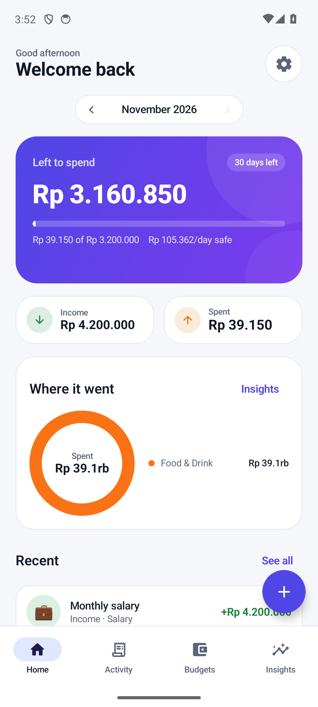
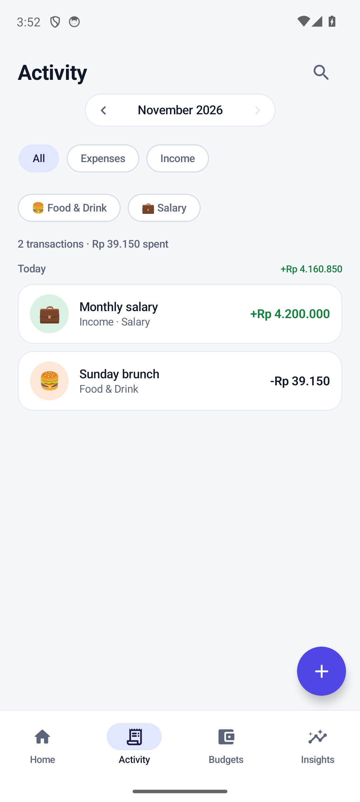
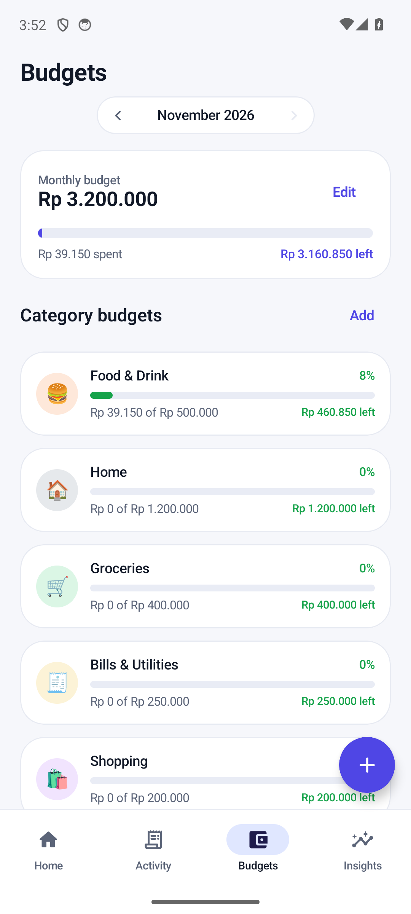
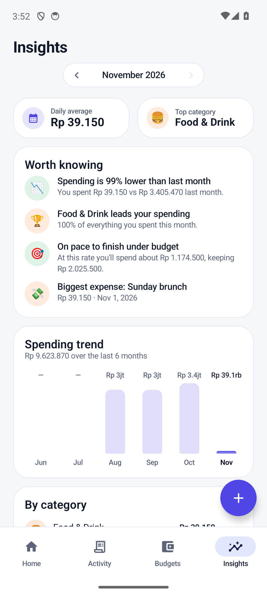
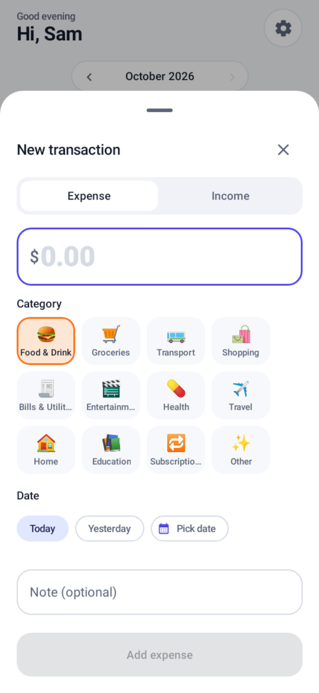
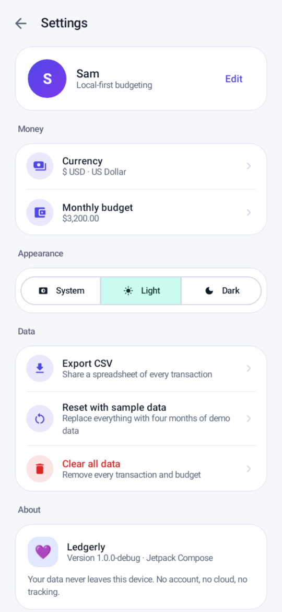

# Ledgerly — Budgeting & Spending Tracker

A private, offline-first personal finance app for Android, built with Kotlin and Jetpack Compose.

Ledgerly keeps your money picture clear without accounts, cloud sync, or tracking. Everything
lives in a local SQLite database on the device.

<p align="center"><em>Log expenses in seconds · budget by category · see where your money goes</em></p>

<p align="center">
  
  
  
  
</p>
<p align="center">
  
  
</p>

## Highlights

**Home dashboard**
- Hero card showing **left to spend** for the month, budget progress and a
  **safe-to-spend-per-day** figure.
- Month switcher to browse history, income/spending tiles, and a category donut chart.
- Budget alerts when a category is close to — or over — its limit.
- Recent transactions with one tap to edit.

**Activity**
- Search notes/categories, filter by expense/income and by category.
- Transactions grouped by day with per-day net totals.
- Swipe a row left to delete, with **Undo** in the snackbar.
- Tap to edit or delete any transaction.

**Budgets**
- Overall monthly budget with progress and remaining amount.
- Per-category monthly limits with colour-coded progress
  (healthy → warning at 80% → over).
- **50:30:20 mode** (opt-in in Settings): enter your monthly income and Ledgerly splits it
  into 50% needs / 30% wants / 20% savings, with a plan card showing each bucket's target,
  spending, remaining and a plain-language verdict. Savings is a category, so logging a
  transfer as a Savings expense counts toward the 20%.
- "Outside category budgets" summary so nothing hides.
- Add/edit/remove budgets from a bottom sheet.

**Insights**
- Daily average, top category, and month-over-month comparison.
- Six-month spending trend chart.
- Full category breakdown with shares.
- Auto-generated highlights: pace vs. budget, subscriptions, biggest expense, overspent budgets.

**Everywhere**
- Add/edit sheet with a big amount pad, emoji category grid, note, and date picker
  (Today / Yesterday / any date).
- 13 expense categories + 4 income categories, each with its own colour and emoji.
- Light / dark / system theme, 19 currencies including **Indonesian Rupiah**, CSV export
  (share sheet), sample data (debug builds only).
- Rupiah-aware money entry: `50000`, `50.000` and `50,000` all mean Rp 50.000, with a live
  preview of the amount that will be saved. IDR is the default for new installs.
- Onboarding that sets your name, currency and monthly budget.

## Install

Prebuilt APKs are attached to each **GitHub Release** — download the APK on your phone
and open it (allow install from unknown sources), or:

```bash
adb install -r ledgerly-1.1.0.apk     # signed release build
```

Requires **Android 8.0+** (minSdk 26).

## Build

```bash
export ANDROID_HOME=/path/to/android-sdk   # SDK 35 + build-tools 35.0.0
./gradlew :app:testDebugUnitTest           # 36 unit tests
./gradlew :app:assembleDebug               # debug APK
./gradlew :app:assembleRelease             # release APK
```

`local.properties` must point at your SDK (`sdk.dir=...`).

### Signing a release build

Signing credentials are **not** in the repo. Create a keystore and add these keys to
`local.properties` (already git-ignored), or set the same names as environment variables:

```properties
LEDGERLY_KEYSTORE=keystore/ledgerly.jks
LEDGERLY_KEYSTORE_PASSWORD=…
LEDGERLY_KEY_ALIAS=ledgerly
LEDGERLY_KEY_PASSWORD=…
```

Without those keys, `assembleRelease` still works but produces an unsigned APK.

CI signs tagged releases with a keystore held in repo secrets (`LEDGERLY_KEYSTORE_BASE64`,
`LEDGERLY_KEYSTORE_PASSWORD`, `LEDGERLY_KEY_ALIAS`, `LEDGERLY_KEY_PASSWORD`). The keystore
must not change: a new key means Android refuses to install the update over the old app.

## How this was built

This project follows a documented build style: pure, tested domain logic; a token-based
design system; local-first data; and a verify-by-running loop. Two files capture it:

- [`AGENTS.md`](AGENTS.md) — operating manual for AI coding agents in this repo
  (commands, layout, rules, definition of done). `CLAUDE.md` points to it.
- [`docs/APP_BUILD_STYLE.md`](docs/APP_BUILD_STYLE.md) — the portable playbook, including a
  copy-paste prompt you can give any AI on any project.

## Architecture

```
app/src/main/java/com/ledgerly/app/
├── MainActivity.kt              # edge-to-edge entry point
├── data/
│   ├── Models.kt                # Transaction, Budget, AppSettings, categories
│   ├── LedgerDatabase.kt        # SQLiteOpenHelper (transactions + budgets)
│   ├── LedgerRepository.kt      # DB + SharedPreferences access
│   └── SampleData.kt            # deterministic 4-month demo dataset
├── ui/
│   ├── App.kt                   # theme, tabs, FAB, sheets, navigation
│   ├── AppViewModel.kt          # StateFlow state + coroutine writes
│   ├── components/              # cards, charts, transaction row
│   ├── screens/                 # Home, Activity, Budgets, Insights, Settings, Onboarding
│   ├── sheets/                  # transaction / budget editors, amount dialog
│   └── theme/                   # colour scheme, typography, shapes
└── util/
    ├── Money.kt                 # cent-based parsing/formatting, currencies
    ├── BudgetMath.kt            # pure aggregation/insight functions (unit tested)
    ├── DateFormats.kt
    └── CsvExporter.kt
```

- Money is stored as **integer cents** to avoid floating-point drift.
- Money formatting and parsing are currency-aware: `Money.format` renders `Rp 1.234.567` for
  IDR and keeps the existing `$1,234.56` output for two-decimal currencies; `Money.parseToCents`
  takes the currency so rupiah grouping is read correctly.
- All statistics are pure functions in `BudgetMath` and covered by unit tests. The 50/30/20
  split (`splitIncome`) rounds down and lets savings take the remainder, so the three parts
  always sum back to the income.
- Category→bucket mapping lives on `Category.bucket`; there is no per-category override UI yet.
- Budget style (`SIMPLE` / `RULE_50_30_20`) and monthly income are stored in the existing
  SharedPreferences keyspace — no database migration.
- State is exposed from the ViewModel as `StateFlow`; writes go to `Dispatchers.IO`.
- No third-party runtime dependencies beyond AndroidX/Compose — no ads, no analytics,
  no network permission at all.

## Continuous integration

`.github/workflows/android.yml` runs the unit tests and builds both APKs on every push and
pull request (artifacts are uploaded). Pushing a `vX.Y.Z` tag builds a signed release APK and
publishes it to GitHub Releases using `docs/release-notes/vX.Y.Z.md` as the description, so a
release only needs the tag and the notes file to exist.

## Tests

21 JVM unit tests cover money parsing/formatting (including zero-decimal currencies like JPY
and whole-unit currencies like IDR) and the budgeting math (summaries, slices, budget status,
projections, trends, the 50/30/20 split and bucket aggregation).

```bash
./gradlew :app:testDebugUnitTest
```

## Privacy

Ledgerly requests **no permissions** — not even internet access. Your transactions never
leave the device unless you explicitly export them.

## Demo data

The four months of sample transactions and the suggested monthly budget are **debug-only**.
`SampleData.available` is `BuildConfig.DEBUG`, and release builds ship with an empty ledger:
no sample-data switch in onboarding, no "Reset with sample data" row in Settings, no
"Load sample data" link on Home, and no prefilled budget figure. A release install starts at
zero and only ever holds what you enter.

## License

MIT — see [LICENSE](LICENSE).

## What I'd build next

- Per-category bucket overrides (e.g. move Travel from wants to needs)
- "Apply plan to category budgets" — seed per-category limits from the 50:30:20 split
- Per-bucket pace warnings on Home
- Recurring transactions and upcoming-bill reminders
- Home-screen widget with the "left to spend" figure
- Multiple accounts/wallets
- Receipt photo attachments
- Backup/restore of the SQLite database
- Optional biometric lock
